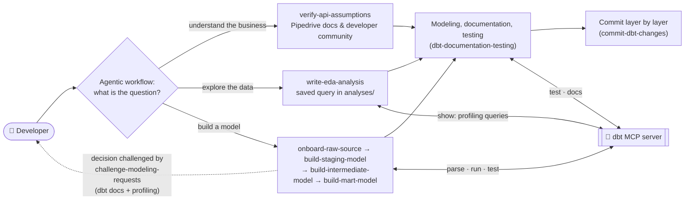
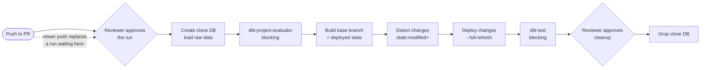

# Pipedrive Sales Funnel: dbt Project

A dbt project on Postgres that models Pipedrive CRM data into reusable layers (sources → staging → intermediate → marts).

The repository is **human-directed and agent-executed**: a developer sets the goals and makes every modeling decision, and an AI agent (Claude Code) does the work by following the rules and skills committed in `.claude/`. See [How the repo works](#how-the-repo-works-human-directed-agent-executed).

## Contents

- [Quickstart](#quickstart)
- [Configure credentials](#configure-credentials)
- [Repository structure](#repository-structure)
- [How the repo works: human-directed, agent-executed](#how-the-repo-works-human-directed-agent-executed)
- [Project features](#project-features)
- [Contributing](#contributing)

## Quickstart

**Prerequisites**: Docker Desktop, Python 3.9 or newer (check with `python3 --version`), git. The project is tested with:

| Component | Version |
|---|---|
| Docker Engine (Docker Desktop) | 29.8.2 |
| Docker Compose | 5.6.0 |
| PostgreSQL | 18.6 (15 or newer required) |
| git | 2.50.1 |
| Python | 3.9.6 |
| dbt-core | 1.10.23 (pinned in `requirements.txt`) |
| dbt-postgres | 1.9.1 (pinned in `requirements.txt`) |
| dbt packages: elementary, dbt_utils, dbt_project_evaluator | 0.20.1, 1.4.1, 1.4.1 (pinned in `packages.yml`) |
| Optional: Elementary CLI (`elementary-data`) | 0.20.1 |
| Optional: uv, for the dbt MCP server | 0.13.1 |

```bash
# 1. Clone and enter the repository
git clone https://github.com/compBiophyMete/dbt_project.git
cd dbt_project

# 2. Create your credentials file and export it in this terminal (see Configure credentials)
cp .dotenv/example_env.txt .dotenv/.dev.env    # then replace each ***** with your value
set -a; source .dotenv/.dev.env; set +a

# 3. Start Postgres; the raw Pipedrive CSVs are loaded automatically
docker compose up -d

# 4. Install dbt (pinned versions) and the dbt packages
python3 -m venv .venv
.venv/bin/pip install -r requirements.txt
.venv/bin/dbt deps

# 5. Load the seed, build, then test
.venv/bin/dbt seed
.venv/bin/dbt run
.venv/bin/dbt test
```

Use `dbt run` then `dbt test`, **not** `dbt build`: `dbt build` skips every model downstream of a failing test.

## Configure credentials

> ⚠️ Never write credentials in `profiles.yml` or any committed file, and never commit your env file.

`profiles.yml` and `docker-compose.yml` read every connection value from environment variables, so the database Docker creates and the connection dbt uses always match:

| Variable | Used for |
|---|---|
| `DBT_TYPE` | Adapter type (`postgres`) |
| `DBT_HOST`, `DBT_PORT` | Database host and port |
| `DBT_USER`, `DBT_PASSWORD` | Database user and password |
| `DBT_DATABASE` | Database name |
| `DBT_SCHEMA` | Default target schema |
| `DBT_THREADS` | Number of threads dbt runs with |

Keep them in `.dotenv/.dev.env` (created from [`.dotenv/example_env.txt`](.dotenv/example_env.txt), one `KEY=value` per line, no spaces around `=`). `.dotenv/*.env`, `.env` and `.env.*` are git-ignored. Export the file in every new terminal, as in [Quickstart](#quickstart) step 2, and check the connection with `.venv/bin/dbt debug`.

Postgres applies the user, password and database name only when it first creates the database. After changing them, recreate it with `docker compose down -v` and `docker compose up -d`.

## Repository structure

```text
.
├── models/          # dbt models: staging, intermediate, marts
├── macros/          # reusable SQL macros
├── tests/           # singular tests
├── seeds/           # seed files
├── analyses/        # exploratory data analysis
├── orchestration/   # Airflow DAG
├── .github/         # CI workflow
├── .claude/         # agent rules, skills and task file
├── docs/            # setup guides
└── raw_data/        # raw Pipedrive CSVs
```

## How the repo works: human-directed, agent-executed

The agent picks a skill from [`.claude/skills/`](.claude/skills/) by the kind of question, follows the rules in [`.claude/rules/`](.claude/rules/), and works on the project through the dbt MCP server. The final decision always belongs to the developer, **not the agent**.



- **Rules** ([`.claude/rules/`](.claude/rules/)): apply to every task. Modeling requests are treated as architecture decisions: each is backed by evidence from dbt's documentation and profiling numbers, alternatives are compared, and the developer's decision is recorded in the task file ([`challenge-modeling-requests`](.claude/rules/challenge-modeling-requests.md)); every model is documented and tested to one standard ([`dbt-documentation-testing`](.claude/rules/dbt-documentation-testing.md)); changes are committed layer by layer, without secrets ([`commit-dbt-changes`](.claude/rules/commit-dbt-changes.md)).
- **Research** ([`verify-api-assumptions`](.claude/skills/verify-api-assumptions/SKILL.md)): confirms the business logic the models rely on, such as what a deal ID, an owner or a lost deal means, against Pipedrive's own documentation and developer community, quoting each source with its link. What the documentation doesn't settle is marked as unverified and decided from the data.
- **Task file** ([`.claude/tasks/sales-funnel.md`](.claude/tasks/sales-funnel.md)): records the goal, the current design and every decision, so any session can continue where the last one stopped.
- **Guardrails** ([`.claude/settings.json`](.claude/settings.json)): deny the agent reading env files and running delete commands.

To work on the repo with Claude Code, set up its permissions and the dbt MCP server as described in [docs/claude-code-setup.md](docs/claude-code-setup.md).

## Project features

### Tags and selection

| Tag | Purpose | Select with |
|---|---|---|
| `pipedrive` | project tag: every model and source table of this project | `dbt run --select tag:pipedrive`, `dbt source freshness --select tag:pipedrive` |
| `daily` | schedule tag: any table or incremental model tagged `daily` is refreshed by the daily [Airflow DAG](#orchestration) | `dbt run --select tag:daily+` |
| `incremental` | incremental models with a lookback window; the DAG runs them before the rest | `dbt run --select tag:incremental` |

The tags are set in [`dbt_project.yml`](dbt_project.yml) and repeated in each model's YAML. The DAG also defines the `12h` and `hourly` schedule tags; to use one, tag the model and add the tag to `ACTIVE_SCHEDULES` in the DAG.

### Orchestration

[`orchestration/airflow/dags/dbt_pipedrive_refresh.py`](orchestration/airflow/dags/dbt_pipedrive_refresh.py) refreshes the `daily` models at 03:00 UTC: it checks source freshness, loads the incremental models, then builds every other `daily` model and everything downstream of them in lineage order, from intermediate up to the marts, and finally runs the tests. Test failures are reported by a separate task, so they don't turn the run red.

> **Assumption**: The raw Pipedrive source data is refreshed daily by 03:00 UTC. If the source load finishes later, move the DAG's schedule so it runs after the load.

### Incremental models

After the first build, an incremental model processes only recent rows instead of rebuilding the whole table. The project provides:

| Feature | What it does | Impact |
|---|---|---|
| **Lookback window** ([`incremental_lookback_filter`](macros/incremental_lookback.sql)) | Re-reads the last N days on every run, and a wider window on one weekday | Late-arriving rows inside the window are picked up; rows later than the window need a backfill |
| **Delete hook** ([`delete_rows_missing_upstream`](macros/delete_rows_missing_upstream.sql)) | After each load, removes rows whose key no longer exists in the source | Deleted or merged records disappear downstream too; skipped when the source is empty, so a failed reload can't wipe a table |
| **`incremental` tag** | Marks every model with a lookback window | Run, backfill or rebuild all incremental models together |

```bash
.venv/bin/dbt run --select tag:incremental                          # normal run
.venv/bin/dbt run --select <model> --vars '{lookback_days: 30}'      # backfill: widen the window for one run
.venv/bin/dbt run --select <model> --full-refresh                    # rebuild from scratch
```

`lookback_days` applies to every incremental model in the run, so combine it with `--select`.

### Documentation and observability

| Page | Generate | Shows |
|---|---|---|
| dbt docs | `.venv/bin/dbt docs generate --static`, then open `target/static_index.html` | models, sources, column docs, tests, lineage (layers colour-coded) |
| Elementary report | `.venv/bin/edr report --profiles-dir .edr`, then open `edr_target/elementary_report.html` | test results with failing-row samples, run history |

> **Note**: dbt-project-evaluator is opt-in, so `dbt run`, `dbt test` and `dbt docs generate` leave it out, and its rule results never reach the Elementary report. CI runs it on every pull request. To run it locally, load its exceptions seed first (one of its models reads it while compiling):
>
> ```bash
> .venv/bin/dbt seed --select dbt_project_evaluator_exceptions
> .venv/bin/dbt run --select package:dbt_project_evaluator --vars '{run_evaluator: true}'
> .venv/bin/dbt test --select package:dbt_project_evaluator --vars '{run_evaluator: true}'
> ```

Commands, run from the repository root after a `dbt run` and `dbt test`:

```bash
# export the credentials in this terminal (see Configure credentials)
set -a; source .dotenv/.dev.env; set +a

# dbt docs: build the site, then serve it at http://localhost:8080
.venv/bin/dbt docs generate
.venv/bin/dbt docs serve --port 8080

# dbt docs as one self-contained file instead (no server): open target/static_index.html
.venv/bin/dbt docs generate --static

# Elementary report from the latest test results: open edr_target/elementary_report.html
.venv/bin/edr report --profiles-dir .edr
```

Both are built from your own database and are not committed. The Elementary report needs its CLI and a connection profile: see [docs/elementary-setup.md](docs/elementary-setup.md).

### Continuous integration

> **Note**: the workflow is in the repository but has not been set up yet. It needs a CI Postgres server, its connection details as repository secrets, and the two approval environments (`ci-run-approval`, `ci-db-cleanup`) before it can run.

[`.github/workflows/dbt-ci.yml`](.github/workflows/dbt-ci.yml) runs on every pull request to `main`, once a reviewer approves the run. Developers keep pushing to a PR, so a newer push replaces a run still waiting for approval, and only the latest commit is built. Each approved run creates its own clone database, loads the raw data, checks the code against dbt's best practices, builds the base branch as the deployed state, then rebuilds only the changed models and everything downstream (`state:modified+`, with `--full-refresh`) and tests them. The clone database is kept until a reviewer approves its cleanup, so failures can be inspected first.



## Contributing

1. Branch from `main`; never commit to `main` directly.
2. Follow the project's conventions ([documentation and testing rule](.claude/rules/dbt-documentation-testing.md)):
   - **New source table**: declare every column with its type, add Elementary's `schema_changes_from_baseline` test so a schema change upstream fails loudly, and add a freshness check if the table has a timestamp (thresholds follow the load schedule, e.g. daily: warning after 1 day, error after 2).
   - **New mart**: enforce its contract, so a renamed, dropped or retyped column fails the build.
   - **Every model**: its own YAML with a description and a tested grain; no test thresholds, so a known data issue fails and is explained in the model's description.
3. Build and test locally (see [Quickstart](#quickstart)).
4. Commit in lineage order (sources → staging → intermediate → marts), with a summary line and a why-focused body ([commit rule](.claude/rules/commit-dbt-changes.md)).
5. Open a pull request to `main`.
